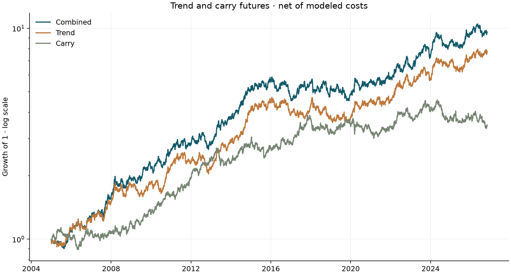

# Trend and carry across futures

Do simple trend and carry rules earn a premium after trading costs across a
diversified futures universe? This project tests that question with daily futures
histories, explicit sector risk budgets and parameter selection confined to past
training windows. From January 2005 through October 2026, the combined strategy
has a net Sharpe ratio of **0.82**, with a maximum drawdown of **22.83%**.

## Data

The panel covers 44 US-listed contracts across eight sectors, with global
underlying exposures. Yahoo Finance supplies front-month price histories;
[FRED](https://fred.stlouisfed.org/series/DTB3) supplies interest rates and yield
curves; the [EIA](https://www.eia.gov/dnav/pet/pet_pri_fut_s1_d.htm) supplies energy
futures settlements. The downloaded histories begin in 2003, with later starts
for contracts whose listings or usable histories begin later.

The builder reconstructs continuous return indices. Energy uses the EIA's first
and second contracts, rolling before expiry. Elsewhere, roll jumps are estimated
with a cost-of-carry model, or the switch-day return is set to zero when no term
structure is available. These are approximations to holding dated contracts.
The contract specifications and expiry rules are maintained in
[`data/market_data`](src/futures_backtester/data/market_data).

Carry is annualized roll yield to a long position: dividend yield less financing
for equity indices, yield less short rates plus estimated roll-down for
Treasuries, foreign less US short rates for FX, and the annualized log ratio of
nearby energy settlements. Twenty-two contracts have some carry history. Carry
is unavailable for metals, grains, softs, livestock and Brent; the EIA energy
history ends on April 5, 2024. Missing carry produces a zero carry allocation.

Market-data redistribution rights are not supplied with this repository, so
downloaded and reconstructed histories stay local under `data/real/`. The builder
and a synthetic generator are included. Both write the same panel schema and
companion files, and both use the same loader. Synthetic data approximates sector
volatility, correlation, carry persistence and trading costs; it does not provide
evidence of investment performance.

## Method

Trend is a trailing price change divided by volatility over the same lookback.
Carry combines its level divided by daily cross-contract dispersion with a
centered cross-sectional rank. Each signal is bounded before sizing.

Contracts use inverse-volatility sizing within each sector. Sector allocations
then receive equal forecast standalone risk, using a trailing covariance matrix
shrunk toward its diagonal. One portfolio scale targets 12% annual volatility,
with gross notional capped at eight times portfolio equity. Equal standalone
sector budgets do not imply equal realized contributions to portfolio variance;
cross-sector correlations also matter. There is no additional correlation
multiplier.

The only parameter search considers trend lookbacks of 63, 126 and 252 sessions
and carry blend weights of 0, 0.35 and 0.65. Every 126 sessions, the highest net
training Sharpe is selected from the preceding 504 sessions. The initial signal
warm-up is excluded from all candidates' training scores. Loading the 2003
history provides training and warm-up before reporting begins in 2005.

Targets use information through a session's close and earn the following
session's return. A contract needs 63 observed daily returns before volatility
sizing becomes available; future observations never fill its initial estimates.
Parameter changes use the actual previous holdings when calculating turnover.
The execution model assumes that closing information can be acted on at that
close; it does not simulate intraday order submission or fills.

Roll costs apply to the position held through the roll day. Commission and
slippage apply to traded notional, including entry and liquidation. Commissions
use the execution day's contract notional rather than a median estimated from
later years. Slippage is fixed at 0.75 basis points per side of turnover. Returns
are futures trading P&L relative to equity, without interest on collateral.

The separate trend sleeve fixes its lookback at 252 sessions; the carry sleeve
uses only the carry signal. Both use the same sector budgets, volatility target
and cost model as the combined strategy, without parameter selection.

## Results

The saved real-data run covers January 3, 2005 to October 30, 2026. Annual return
means the average daily return multiplied by 252; CAGR is saved separately.

| Strategy | Net annual return | Annual volatility | Sharpe | Maximum drawdown |
|---|---:|---:|---:|---:|
| Walk-forward trend and carry | 11.28% | 13.72% | 0.82 | −22.83% |
| Trend only | 10.23% | 13.34% | 0.77 | −24.06% |
| Carry only | 6.52% | 12.79% | 0.51 | −26.78% |

Source: [`reports/real/summary.csv`](reports/real/summary.csv). The combined
strategy's gross annual return is 13.60%; modeled costs subtract 2.32 percentage
points: 0.52 from rolls, 0.57 from commissions and 1.23 from slippage. The
[cost breakdown](reports/real/costs.csv) reconciles gross and net returns daily.



A circular moving-block bootstrap gives a 95% Sharpe interval of **0.40–1.23**,
using 500 resamples and 21-session blocks. These intervals condition on the
observed strategy path; parameter selection is not repeated inside each
resample. The trend sleeve's correlation with an equal-weight basket of equity
index futures is 0.02.

The report directory also contains compounded monthly and yearly returns,
drawdown episodes, rolling volatility and Sharpe, realized sector risk
contributions, the complete walk-forward grid with selected rows, and a regime
table. Configuration, input hashes and package versions are recorded in
[`run_config.json`](reports/real/run_config.json).

The same outputs are saved under [`reports/synthetic`](reports/synthetic). Its
trend and carry sleeve Sharpes are 0.83 and 0.97. A separate, simpler sign-momentum
and rank-carry reference check is recorded in each run configuration. Synthetic
carry is stronger than the calibration target. The simulation gives every
contract a complete history and uses stationary premia, which can make
diversification and signal persistence more favorable than in the real panel.

## Limitations

Carry covers only part of the universe and its coverage changes over time.
Energy carry stops in 2024. Financing and Treasury roll-down are estimated;
missing curves require some roll-day returns to be discarded. Front-month
histories cannot establish the exact return available from trading each dated
contract. Bad-print filtering and fixed data-quality start dates for platinum
and palladium also affect the reconstructed history.

The universe is a fixed list of US-listed contracts. Observed listing dates are
respected, but the list is not a historical census of all listed and discontinued
contracts, so survivorship bias remains possible. Macro histories can be
revised; publication lags and forward filling do not turn them into vintage data.

The volatility target is a forecast, not a constraint on realized risk. Gross
leverage can be substantial, and the model does not include margin calls,
market impact, price limits, collateral yield or funding constraints. Costs
change with prices but do not adapt to market stress. Bootstrap intervals do
not measure uncertainty about these modeling choices.

## Reproduce

In PowerShell, create an environment, install the package and rebuild the local
histories used by the saved run:

```powershell
python -m venv .venv
.venv\Scripts\Activate.ps1
pip install -e ".[dev,data]"
futures-backtest build-data --out data/real --end 2026-10-30
futures-backtest run --data-dir data/real --end 2026-10-30 --output-dir reports/real
```

On macOS or Linux, activate with `source .venv/bin/activate`. Downloads are cached
under `.cache/market_data`; set `MARKET_DATA_REFRESH=1` to request fresh responses.
Source revisions or different package versions may change a rebuilt dataset;
the saved hashes identify the exact inputs used here.

The synthetic run needs no downloads. The first command writes a reusable
dataset; the second regenerates that same seeded sample through the shared
serialization and loading path:

```powershell
futures-backtest sample-data --out data/synthetic
futures-backtest run --output-dir reports/synthetic
```

To use an existing dataset, pass `--data-dir data/synthetic`. For a shorter smoke
run, use `futures-backtest run --days 780 --contracts 12 --bootstrap-samples 25
--output-dir reports/smoke`. Each run writes ten report files and `run_config.json`.
The standalone synthetic commands need only the base package; downloading real
histories requires the `data` extra.

Run `ruff check .` and `pytest` for validation. CI builds synthetic data only.
The tests check schema compatibility, missing carry, late listings, unchanged
past signals and weights after truncation, sector risk budgets and cost timing.
The private-data schema comparison is skipped when `data/real/` is absent.
